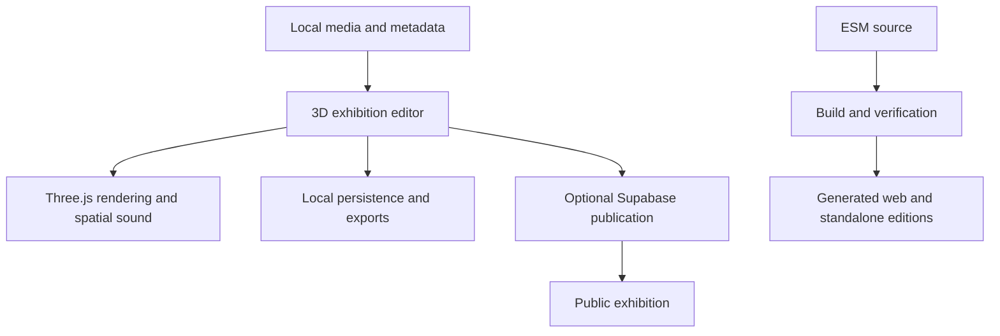

# Galerie — Studio Niko Design

**Immersive browser exhibition · Three.js · Local media editing · Optional publication**

[Source ESM](src/galerie.html) · [Guide](guide.html) · [Sécurité](SECURITY.md) · [English overview](#english-overview)

## Architecture réelle



| Source | Fonction constatée |
| --- | --- |
| [src/galerie.html](src/galerie.html) | Three.js, OrbitControls, post-traitement, chargement de modèles et audio positionnel |
| [tools/build.sh](tools/build.sh) | Construction des éditions générées |
| [supabase/schema.sql](supabase/schema.sql) | Fonctions de publication et mise à jour, politiques de stockage |
| [backup-2d.js](backup-2d.js) | Validation des sauvegardes de l'édition 2D |

La source utilise notamment EffectComposer, UnrealBloomPass, GLTFLoader et PositionalAudio. Les images sont réduites à une dimension maximale de 2048 pixels dans le chemin de traitement prévu. Le confort de rendu dépend de la mémoire, du GPU et des médias ; aucune performance mesurée n'est revendiquée.

> **Projet signature · 02/06 · ART 3D** — [Étude de projet : problème, choix techniques et limites](https://github.com/Nikoju1977/Nikoju1977/blob/main/SHOWCASE.md) · [Portfolio Studio Niko Design](https://github.com/Nikoju1977).


Galerie d'art en 3D dans le navigateur. Un seul fichier HTML, sans backend obligatoire.
Accroche tes tableaux, projette tes films, pose tes sculptures, fais résonner ta musique.

**Adresse annoncée (non vérifiée ici) :** https://galerie-studio-niko-nikoju1977s-projects.vercel.app
**Mode d'emploi :** https://galerie-studio-niko-nikoju1977s-projects.vercel.app/guide.html

---

## Les fichiers

| Fichier | Rôle |
|---|---|
| `index.html` | Version servie en ligne — Three.js via CDN, code minifié |
| `galerie-autonome.html` | Tout embarqué — fonctionne hors-ligne, même en `file://` |
| `guide.html` | Fiche explicative destinée aux artistes |
| `src/galerie.html` | **La source** — module ESM lisible, c'est ce fichier qu'on modifie |
| `tools/` | Chaîne de construction et de vérification |
| `supabase/schema.sql` | Schéma de la publication en ligne |

Les deux premiers sont **produits** par `tools/build.sh` à partir de la source. Ne les édite pas
directement : la prochaine construction les écrase.

## La salle

- **48 × 32 m**, plafond à 7,40 m, coupole à caissons culminant à 11,90 m avec oculus
- **100 emplacements** d'accrochage, ligne médiane à 1,55 m (norme muséale), projecteurs à 30° d'incidence
- **3 vidéoprojections** murales, recul calculé sur un rapport de projection de 1,5
- **8 socles** de sculpture (.glb), **10 socles** sonores spatialisés, un téléviseur, un pupitre de livre d'or
- Éclairage réglable : 3 ambiances et 6 curseurs

## Ce qu'on peut y faire

**Déposer** images, vidéos, sons et modèles 3D — au bouton ou par glisser-déposer. Les images sont
réduites à 2048 px, l'emplacement libre le plus proche est choisi automatiquement.

**Composer** : déplacer une œuvre d'un mur à l'autre, renseigner titre, année, technique, dimensions
et **prix**, régler la lumière, construire une playlist.

**Cartels** aux normes : auteur, titre en italique, année, technique, dimensions, notice.
Traduits dans 9 langues (vocabulaire des techniques intégré, titre et notice via Mistral).

**Livre d'or** : un pupitre à l'entrée. Local tant que la galerie n'est pas publiée, partagé ensuite.

**Publier en ligne** : ta galerie obtient une adresse `?g=ton-nom` qui montre **tes œuvres** à
quiconque l'ouvre. Nécessite un code d'invitation.

**Mode exposition** : masque tous les outils d'édition — la salle se visite sans pouvoir être modifiée.

**9 langues** : français, anglais, allemand, espagnol, italien, portugais, néerlandais, polonais, tchèque.
La langue de l'appareil est détectée au premier lancement.

## Construire

```bash
./tools/build.sh
```

La chaîne **refuse de produire** si une vérification échoue :

| Étape | Ce qu'elle attrape |
|---|---|
| `smoketest.mjs` | Le module s'exécute-t-il ? Ouverture d'une œuvre, cadrage, orientation caméra, routage des dépôts, placement des projecteurs, coupole, langues |
| `verify.mjs` | 130 contrôles : structure, normes muséales, mobilier sans chevauchement, publication, sauvegarde, sécurité |
| `ordre.js` | Variable utilisée avant sa déclaration — panne silencieuse, `const` devenant `var` au regroupement |
| `audit.mjs` | Fonctions dupliquées ou manquantes, classes CSS absentes, boutons sans action, traces de mise au point |
| `test-mistral.mjs` | Reprise sur limite de débit (429), délai imposé par le serveur, clé invalide |

Chacun de ces tests est né d'un vrai bug rencontré. Ils existent pour qu'il ne revienne pas.

## Publication en ligne

Base et stockage sur Supabase. Le schéma est dans `supabase/schema.sql`.

- La clé intégrée est **publishable** : conçue pour être visible dans une page web, elle ne permet
  que la lecture des galeries et le dépôt de médias.
- La publication et la mise à jour des enregistrements de galerie utilisent des fonctions serveur avec **code d'invitation** ou **jeton d'édition**. Les écritures de médias relèvent de politiques distinctes.
- Le schéma fourni ne démontre pas une restriction suffisante des dépôts de médias à une galerie autorisée. Vérifier et renforcer les politiques de stockage avant ouverture des écritures publiques.
- Les codes d'invitation sont invisibles depuis le web.
- Vidéos et modèles 3D ne sont pas publiés : ils resteraient trop lourds pour l'offre gratuite.

## Conventions

Studio Niko Design — HTML single-file, **XHR uniquement** (jamais `fetch`), `safeStorage`
(IndexedDB avec repli mémoire), clés chiffrées AES-256-GCM/PBKDF2, polices Cinzel et
Cormorant Garamond, mobile `100dvh` + safe-area, validation obligatoire avant livraison.


## Galerie 2D : sauvegarde restaurable et suppressions sûres — 22 novembre 2026

Le mode `galerie-2d.html` propose désormais **Sauvegarder JSON** et **Restaurer JSON**. Ce format éditable inclut les images et leurs cartels ; l'export HTML existant demeure réservé à la présentation et ne constitue pas un fichier de reprise. Un lien de téléchargement manuel reste affiché cinq minutes pour contourner les restrictions des navigateurs mobiles sur les clics automatiques différés.

La restauration accepte les formats PNG/JPEG/WebP/GIF, maximum 15 Mo par image, 100 œuvres et 64 Mo par sauvegarde ; ces limites peuvent empêcher une sauvegarde JSON de très grandes expositions. **Un dépassement provoque une erreur explicite sans export partiel.** Le JSON entier est validé avant l'écriture ; les images sont converties en mémoire puis ajoutées au sein d'une transaction IndexedDB. Les identifiants déjà présents sont ignorés, les œuvres existantes conservées, et l'import requiert confirmation. Une suppression d'œuvre nécessite désormais confirmation. En mode dégradé sans IndexedDB, les données sont conservées seulement en mémoire jusqu'à fermeture ; l'interface le signale.

Le mécanisme est strictement local : aucun compte, aucune synchronisation ni transmission automatique. Les fichiers JSON contiennent les images en Base64 et peuvent être volumineux : sauvegardez-les en lieu sûr. Le parcours WebGL 3D n'est pas modifié par ce changement. Les tests Chromium et les essais sur appareils réels doivent être distingués de la disponibilité publique.


## Qualification proposée — rendu, conservation et publication

Vérifier sur œuvres fictives l'import, le placement, la navigation, les cartels, le son, les sauvegardes et la restauration. Comparer la source ESM aux éditions générées après construction. Tester séparément l'édition 2D et le rendu 3D sur appareils représentatifs. Les fonctions distantes nécessitent un environnement Supabase de test autorisé ; vérifier les politiques d'accès, les droits d'édition, les quotas, la suppression et la publication volontaire.

**Point prioritaire :** le schéma SQL fourni ne suffit pas à établir que chaque dépôt de média est limité à une galerie autorisée. Revoir les politiques de stockage et vérifier leur déploiement avant d'ouvrir les écritures publiques. Le code d'invitation et le jeton d'édition des fonctions de publication ne prouvent pas la protection des téléversements. Aucun test de sécurité, aucune publication d'œuvre et aucun nouveau rendu n'ont été réalisés pour cette révision.

Le manifeste [package.json](package.json) indique MIT, mais aucun fichier de licence autonome n'a été identifié à la racine inspectée. Les droits sur les œuvres, bibliothèques, musiques et modèles restent distincts ; clarifier les conditions avant redistribution.

## English overview

The gallery is an immersive Three.js exhibition editor with spatial audio, media placement, metadata, local persistence, generated standalone and web editions, and optional Supabase publication. The repository includes build and regression checks, but their presence is not proof of new successful execution. Storage authorization needs review before opening uploads. The npm manifest declares MIT; no standalone root license was identified. Third-party and artwork rights remain separate. No new runtime, security or deployment validation was performed.
